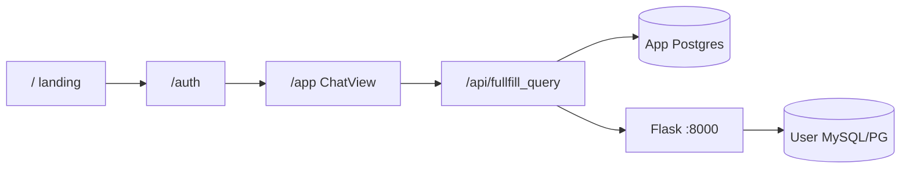

# Memplace (project memory)

Agents: read this file at the start of related tasks and update it when architecture or fixes change.

## Product routes (Next.js)

| URL | Purpose |
|-----|--------|
| `/` | Public landing (`client/public/landing.html` iframe) |
| `/auth` | Sign in / sign up / forgot password |
| `/app` | Main SQL AI app (session required; redirects to `/auth` if logged out) |
| `/login` | Redirect → `/auth` |
| `/reset-password?token=…` | Set new password from email link |

Landing **Sign in** / **Get Started** links → `/auth`. After OAuth or email login, callback → **`/app`**.

## Auth (Next.js + Postgres)

- **NextAuth** (`client/app/api/auth/[...nextauth]/route.ts`): Google and GitHub only if env vars set; email **Credentials** always.
- **OAuth** upserts `users` (name, email, image); **credentials** use `password_hash` on `users` (`ensureAuthTables`).
- **Sign up**: `POST /api/auth/signup` (bcrypt hash).
- **Forgot**: `POST /api/auth/forgot` → Nodemailer reset link → `password_resets` table (1h token).
- **Reset**: `POST /api/auth/reset` with token + new password.
- **SessionProvider** in `StoreProvider` for client `signIn()`.
- Google redirect URI: `{NEXTAUTH_URL}/api/auth/callback/google`.

**Client env** (see `client/.env.example`): `NEXTAUTH_URL`, `NEXTAUTH_SECRET`, `GOOGLE_*`, `GITHUB_*`, `DATABASE_URL`, `FLASK_URL`, `SMTP_*` (`SMTP_FROM` = visible From address; defaults to `SMTP_USER`).

**Server env** (`server/.env`): `OPENROUTER_API_KEY=sk-or-...` **no extra quotes** (``""key""`` breaks dotenv). Loaded via `server/core/config.py` absolute path.

## UI structure

**Sidebar**
- **Chat** → New Chat, History
- **Database** → **Configuration** (data source cards, add/edit), **Schemas** (table browser)

**Configuration** (`db_list`, `DatabaseList.tsx`): cards open connection editor; no schema dropdown on cards.

**Schemas** (`db_schemas`, `DatabaseSchemasView.tsx`): DB cards → Flask `/api/schema` → `parseSchemaDdl` → **table dropdown** + CREATE TABLE DDL per table.

**Chat**
- Generate → `POST /api/fullfill_query` with `databaseId`, `chatSessionId`, `history`.
- Messages + sessions in Postgres: `chat_sessions`, `chat_messages` (`ensureChatTables` on first use).
- History: `GET /api/chats`, `GET /api/chats/[id]` — no mock data.

**Redux** (`appSlice`): `activeDbId`, `schemaTables`, `schemasViewDbId`, `activeChatSessionId`, `messages`.

## Text-to-SQL pipeline

1. Next loads **credentials** from `saved_databases` for the signed-in user.
2. Flask **`fetch_schema`**: `MetaData.reflect()` → CREATE TABLE DDL (`schema_reflect_ddl.py`) — aligned with **`Ai-course/3-text-to-sql/agent.py`**.
3. LLM: OpenRouter, JSON `{ sql, explanation }` (`llm_service.py`, `llm_json_parse.py` with fallbacks).
4. **`w3schools_sql.py`**: PascalCase table names for MySQL before execute.
5. Response: SQL + rows to client; Next saves user + AI rows to `chat_messages`.

## Reference: course agent.py

- Path: `~/Desktop/practise-and-make/Ai-course/3-text-to-sql/agent.py`
- MySQL host `192.168.1.42:5246`, database **`w3schools`** (not `mysql` system DB).
- Saved connection in app must match: engine **MySQL**, `db_name=w3schools`.

## Known pitfalls (resolved)

| Issue | Cause | Fix |
|-------|--------|-----|
| OPENROUTER missing at runtime | `""key""` in `.env` | Unquoted `KEY=value`; `config.py` loads `server/.env` by path |
| Empty schema / LLM “which table has country?” | Wrong PG schema introspection or wrong MySQL `db_name` | DDL reflect; point `db_name` at real DB |
| JSON parse errors from model | Markdown / non-strict JSON | `llm_json_parse.py` fallbacks |
| Google OAuth broken | Empty GitHub provider / wrong callback | Conditional providers; `/auth`; callback `/app` |
| GitHub `redirect_uri` not associated | Callback URL missing in **OAuth App** (not GitHub App) | Register `{NEXTAUTH_URL}/api/auth/callback/github` exactly |
| Landing Sign in stuck on `/` | Links opened inside landing iframe | `/auth` links use `target="_top"` in `landing.html` |
| Auth inputs invisible | Dark `prefers-color-scheme` + inherited text color | `bg-white text-slate-900` + labels on `/auth` |
| Forgot password no email | Only sent when `password_hash` set (OAuth-only users skipped) | Send for any registered email; reset sets `password_hash` |

## Key files

| Path | Role |
|------|------|
| `client/app/page.tsx` | Landing iframe |
| `client/app/auth/page.tsx` | Auth page |
| `client/app/app/page.tsx` | Protected app shell |
| `client/components/AuthView.tsx` | Google/GitHub/email UI |
| `client/lib/parseSchemaDdl.ts` | Split DDL into tables |
| `client/lib/ensureChatTables.ts` | `chat_sessions` / `chat_messages` |
| `client/lib/ensureAuthTables.ts` | `password_hash`, `password_resets` |
| `client/lib/sendResetEmail.ts` | Nodemailer reset mail |
| `client/app/api/chats/*` | Chat list + load |
| `client/app/api/fullfill_query/route.ts` | Flask proxy + persist messages |
| `server/services/chat_service.py` | Orchestrate schema → LLM → SQL |
| `server/services/schema_reflect_ddl.py` | DDL for LLM |
| `server/tests/test_flow.py`, `test_w3schools_schema.py` | Offline Flask tests (SQLite + fake LLM) |

## Tests & logs

- Human test log: `tests/test_cases.md`
- Session audit: `server/data/sessions/<session_id>/*.log` (rule1)

## Operational

- Restart **Flask** after `server/.env` or server code changes.
- Restart **Next** after `client/.env` or auth changes.
- Flask logs: `schema_reflect_ddl`, `fullfill_query`, `llm_service`.

## Last updated

2026-11-04 — Landing palette on `/auth` and `/app`
- Shared `LandingGlow`: indigo / cyan / blue blobs on `slate-950`.
- Auth form is dark (explicit `text-slate-100` inputs). Logo and CTAs use indigo→cyan, same as landing.
- App sidebar, header, and chat composer use that glow and gradient. Violet accents replaced with cyan.

2026-11-04 — OAuth UI, landing auth links, authOptions module
- Landing `/auth` links: `target="_top"` (iframe was trapping navigation).
- Auth: Google/GitHub SVG icons; OAuth error hints + callback URLs from `/api/auth/providers`.
- `lib/authOptions.ts` + `lib/oauthEnv.ts`; `force-dynamic` on `/auth` and `/app` (Next 16 session).
