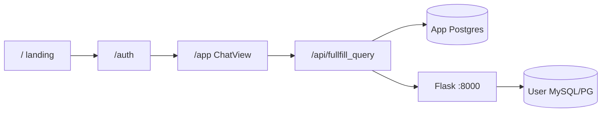

# Memplace (project memory)

Agents: read this file at the start of related tasks and update it when architecture or fixes change.

## Mobile app (`mobileApp/`)

Expo app with the same signed-in product as `/app` (no landing page).

| Screen | Same as |
|--------|---------|
| Sign in / sign up / forgot | `/auth` |
| Reset token | `/reset-password` |
| Chat, History, Config, Schemas | sidebar in `/app` |

- Talks to the Next API (`EXPO_PUBLIC_API_URL` in `mobileApp/.env`; copy `mobileApp/.env.example`). Default `http://localhost:3000`. Android emulator uses `http://10.0.2.2:3000`.
- Google and GitHub buttons stay on the sign-in screen, with brand icons.
- Native Google: `@react-native-google-signin/google-signin` returns an idToken, `POST /api/auth/mobile/google` checks it and returns the app session token.
- Native GitHub: `react-native-app-auth` sends the code to `POST /api/auth/mobile/github/token` (client secret stays on the Next server). Redirect to register on the GitHub OAuth App: `sqlai://oauth/github`.
- These native modules need a dev build (`npx expo run:android`), not Expo Go. The web build still uses the browser handoff.
- Header (Chat tab): QueryAI on the left, database dropdown in the center, profile circle on the right. Other tabs: QueryAI and profile only (no database dropdown). Sign out is on Profile.
- Email login: `POST /api/auth/mobile/login` → bearer token (`client/lib/mobileToken.ts`). Website still uses the NextAuth cookie.
- Google/GitHub: browser opens `/auth/mobile`, then `/api/auth/mobile/handoff` redirects to `sqlai://auth?token=` (or the Expo Go `exp://` return URL).
- APIs accept `Authorization: Bearer` via `getRequestUser` (databases, chats, schema, fullfill_query).
- Forgot email includes the website link and `sqlai://reset-password?token=`.
- Android emulator: set `EXPO_PUBLIC_API_URL=http://10.0.2.2:3000`. A phone on Wi-Fi needs the computer's LAN IP.
- Run: `cd mobileApp && npm start`.

## Product routes (Next.js)

| URL | Purpose |
|-----|--------|
| `/` | Public landing (`client/public/landing.html` iframe) |
| `/auth` | Sign in / sign up / forgot password |
| `/app` | Main QueryAI app (`AppGate` client session → `/auth` if logged out; no server `getServerSession` in build) |
| `/login` | Redirect → `/auth` |
| `/reset-password?token=…` | Set new password from email link |

Landing **Sign in** / **Get Started** links → `/auth`. After OAuth or email login, callback → **`/app`**.

## Auth (Next.js + Postgres)

- **NextAuth** (`client/lib/authOptions.ts`, handler in `client/app/api/auth/[...nextauth]/route.ts`): Google and GitHub only if env vars set; email **Credentials** always.
- **OAuth** upserts `users` (name, email, image); **credentials** use `password_hash` on `users` (`ensureAuthTables`).
- **Sign up**: `POST /api/auth/signup` (bcrypt hash).
- **Forgot**: `POST /api/auth/forgot` → Nodemailer reset link → `password_resets` (1h token). Sends for **any registered email** (OAuth-only users too); reset sets `password_hash`.
- **Reset**: `POST /api/auth/reset` with token + new password.
- **`/auth` page**: client `useSession` redirect to `/app` when logged in (no server `getServerSession` — avoids Next 16 `cacheComponents` conflict).
- **SessionProvider** in `StoreProvider` for client `signIn()`.
- OAuth redirect URIs: `{NEXTAUTH_URL}/api/auth/callback/google` and `…/github` (must match GitHub **OAuth App**, not GitHub App).

**Client env** (see `client/.env.example`): `NEXTAUTH_URL`, `NEXTAUTH_SECRET`, `GOOGLE_*`, `GITHUB_*`, `DATABASE_URL`, `FLASK_URL`, `SMTP_*` (`SMTP_FROM` = visible From address; defaults to `SMTP_USER`), **`ADMIN_EMAIL_ID`**.

**Query cap:** non-admin users capped at **`NON_ADMIN_QUERY_LIMIT`** (default 5) on `POST /api/fullfill_query` (count `chat_messages.role = user`). `ADMIN_EMAIL_ID` is unlimited. Header shows “N queries left” via `GET /api/query-quota` (hidden for admin).

**Login mail:** only the **first** sign-in of a new user emails `ADMIN_EMAIL_ID` (subject `New login`). Returning logins are not mailed.

**Login log (Postgres):**
- **`users.welcome_mailed`** (column on `users`, not on `user_logins`): `false` until first sign-in admin mail is sent, then `true`. Not in `client/prisma/schema.prisma` — added at runtime / via SQL script.
- **`user_logins`** (table): one row per sign-in — `email`, `method`, `location`, `local_time`, `timezone`, `created_at` (server). No `welcome_mailed` column here.
- Manual schema: `psql "$DATABASE_URL" -f client/scripts/ensure_login_schema.sql`
- Browser cookies on `/auth`: `qai_geo`, `qai_local`, `qai_tz`.

**Server env** (`server/.env`): `OPENROUTER_API_KEY=sk-or-...` **no extra quotes** (``""key""`` breaks dotenv). Loaded via `server/core/config.py` absolute path.

## UI structure

**Sidebar**
- **Chat** → New Chat, History
- **Database** → **Configuration** (data source cards, add/edit), **Schemas** (table browser)

**Configuration** (`db_list`, `DatabaseList.tsx`): cards open connection editor; no schema dropdown on cards.

**Schemas** (`db_schemas`, `DatabaseSchemasView.tsx`): DB cards → Flask `/api/schema` → `parseSchemaDdl` → **table dropdown** + CREATE TABLE DDL per table.

**Chat**
- Generate → `POST /api/fullfill_query` with `databaseId`, `chatSessionId`, `history`.
- Messages + sessions in Postgres: `chat_sessions`, `chat_messages` (`ensureChatTables` on first use).
- History: `GET /api/chats`, `GET /api/chats/[id]` — no mock data.

**Redux** (`appSlice`): `activeDbId`, `schemaTables`, `schemasViewDbId`, `activeChatSessionId`, `messages`.

**Theme** (match `client/public/landing.html`)
- Page background: `slate-950` (`#020617` in `globals.css`). Text: `slate-50` / `slate-400`.
- Shared blobs: `client/components/LandingGlow.tsx` — indigo-600, cyan-600, blue-600 at 20% with `blur-[100px]`. Used on `/auth`, `/app` main column, and `/reset-password`.
- Brand mark: `bg-gradient-to-br from-indigo-500 to-cyan-500`. Wordmark is `SQL` + `text-indigo-400` on `AI`.
- Headlines: `bg-gradient-to-r from-white via-slate-200 to-slate-500` (clip text). Accent line: `from-indigo-400 to-cyan-400`.
- Primary button: `bg-indigo-600 hover:bg-indigo-500 shadow-lg shadow-indigo-500/25`.
- Chat composer: 1px `from-slate-800 to-slate-900` frame plus `from-indigo-500 to-cyan-500` glow (same idea as the landing terminal).
- Auth inputs are **dark**: `bg-slate-900 text-slate-100 border-slate-700`. Do not switch them back to white; the old light form clashed with the landing theme. Keep an explicit text color so a dark OS preference cannot hide the typed value.

## Text-to-SQL pipeline

1. Next loads **credentials** from `saved_databases` for the signed-in user.
2. Flask **`fetch_schema`**: `MetaData.reflect()` → CREATE TABLE DDL (`schema_reflect_ddl.py`) — aligned with **`Ai-course/3-text-to-sql/agent.py`**.
3. LLM: OpenRouter, JSON `{ sql, explanation }` (`llm_service.py`, `llm_json_parse.py` with fallbacks).
4. **`w3schools_sql.py`**: PascalCase table names for MySQL before execute.
5. Response: SQL + rows to client; Next saves user + AI rows to `chat_messages`.

## Reference: course agent.py

- Path: `~/Desktop/practise-and-make/Ai-course/3-text-to-sql/agent.py`
- MySQL host `192.168.1.42:5246`, database **`w3schools`** (not `mysql` system DB).
- Saved connection in app must match: engine **MySQL**, `db_name=w3schools`.

## Known pitfalls (resolved)

| Issue | Cause | Fix |
|-------|--------|-----|
| OPENROUTER missing at runtime | `""key""` in `.env` | Unquoted `KEY=value`; `config.py` loads `server/.env` by path |
| Empty schema / LLM “which table has country?” | Wrong PG schema introspection or wrong MySQL `db_name` | DDL reflect; point `db_name` at real DB |
| JSON parse errors from model | Markdown / non-strict JSON | `llm_json_parse.py` fallbacks |
| Google OAuth broken | Empty GitHub provider / wrong callback | Conditional providers; `/auth`; callback `/app` |
| GitHub `redirect_uri` not associated | Callback URL missing in **OAuth App** (not GitHub App) | Register `{NEXTAUTH_URL}/api/auth/callback/github` exactly |
| Landing Sign in stuck on `/` | Links opened inside landing iframe | `/auth` links use `target="_top"` in `landing.html` |
| Auth inputs invisible | Dark `prefers-color-scheme` + inherited text color | Explicit `text-slate-100` on dark inputs (`bg-slate-900`). Do not rely on inherited color |
| Forgot password no email | Only sent when `password_hash` set (OAuth-only users skipped) | Send for any registered email; reset sets `password_hash` |

## Key files

| Path | Role |
|------|------|
| `client/app/page.tsx` | Landing iframe |
| `client/app/auth/page.tsx` | Auth page |
| `client/app/app/page.tsx` | Protected app shell |
| `client/components/AuthView.tsx` | Google/GitHub/email UI + OAuth icons |
| `client/components/LandingGlow.tsx` | Shared indigo / cyan / blue backdrop |
| `client/lib/authOptions.ts` | NextAuth providers + callbacks |
| `client/lib/oauthEnv.ts` | `NEXTAUTH_URL`, OAuth env aliases |
| `client/lib/parseSchemaDdl.ts` | Split DDL into tables |
| `client/lib/ensureChatTables.ts` | `chat_sessions` / `chat_messages` |
| `client/lib/ensureAuthTables.ts` | `password_hash`, `password_resets` |
| `client/lib/sendResetEmail.ts` | Nodemailer reset mail |
| `client/app/api/chats/*` | Chat list + load |
| `client/app/api/fullfill_query/route.ts` | Flask proxy + persist messages |
| `client/lib/getRequestUser.ts` | Cookie session or mobile bearer token |
| `mobileApp/` | Expo app (auth, chat, history, databases, schemas) |
| `server/services/chat_service.py` | Orchestrate schema → LLM → SQL |
| `server/services/schema_reflect_ddl.py` | DDL for LLM |
| `server/tests/test_flow.py`, `test_w3schools_schema.py` | Offline Flask tests (SQLite + fake LLM) |

## Tests & logs

- Human test log: `tests/test_cases.md`
- Session audit: `server/data/sessions/<session_id>/*.log` (rule1)

## Operational

- Restart **Flask** after `server/.env` or server code changes.
- Restart **Next** after `client/.env` or auth changes.
- Flask logs: `schema_reflect_ddl`, `fullfill_query`, `llm_service`.

## Last updated

2026-11-04 — React Native app in `mobileApp/`
- Expo app: auth, reset, chat, history, database config, schemas. No landing page.
- Bearer token for mobile (`/api/auth/mobile/login`, `/me`, OAuth handoff). Cookie session unchanged for the website.
- `getRequestUser` on database, chat, schema, and query routes. CORS proxy in `client/proxy.ts`.
- `mobileApp/.env`: `EXPO_PUBLIC_API_URL`.

2026-11-04 — Landing palette on `/auth`, `/app`, and reset
- `LandingGlow` on auth, app main column, and reset-password.
- Auth is a dark card (no light right panel). Inputs: `bg-slate-900 text-slate-100`.
- Logo, headlines, primary buttons, and chat composer follow landing: slate-950, indigo→cyan, indigo-600 CTA shadow.
- Violet logo/avatar gradients removed.

2026-11-04 — Auth / OAuth / forgot-password (memplace sync)
- `lib/authOptions.ts` + `lib/oauthEnv.ts`; thin NextAuth route handler.
- Landing `/auth` links: `target="_top"` in `landing.html`.
- AuthView: Google/GitHub SVG icons; optional OAuth error banner from `?error=` + `/api/auth/providers` callback URLs.
- Forgot password: email for OAuth-only users; case-insensitive email lookup.
- GitHub `redirect_uri`: register `{NEXTAUTH_URL}/api/auth/callback/github` on OAuth App; `NEXTAUTH_URL` must match browser host/port.
- Removed temporary “GitHub sign-in setup” UI from `/auth` (no `/api/auth/oauth-setup`).

## Docker (repo root)

- `docker-compose.yml`: **postgres**, **server** (Flask), **client** (Next) on shared bridge network **`queryai`**. Only **client** publishes a host port (`CLIENT_PORT`, default 3000). Postgres and Flask are not exposed on the host.
- `server/Dockerfile` — Python 3.11 + gunicorn `app:app`.
- `client/Dockerfile` — multi-stage Next `standalone` (`output: "standalone"` in `next.config.ts`).
- Env: **`client/.env`** and **`server/.env`** via `env_file` (copy from `.env.example`). No `compose.env`.
- Compose overrides on **client** only: `DATABASE_URL` → `postgres:5432`, `FLASK_URL` → `http://server:8000`. Set `NEXTAUTH_URL` to how you open the app (e.g. `http://192.168.1.42:3000` on LAN).
- Run: `docker compose up --build` from repo root (requires `client/.env` and `server/.env` to exist).
- Browser still uses `NEXTAUTH_URL=http://localhost:3000` (host port mapping).

## Git ignore

- Single root `.gitignore` covers **client**, **server**, **mobileApp**. Templates: `.env.example` in each app folder.
- `server/data/` is ignored (agent session logs).
- **`docs/memplace.md` is tracked and pushed.** `mempalace.yaml` / `entities.json` are the MemPalace tool cache only; those stay ignored.

## SEO (no UI change)

- Brand in **meta / JSON-LD / OG**: **QueryAI** (text-to-SQL AI).
- Databases listed for crawlers: PostgreSQL, MySQL, MariaDB, SQLite, Microsoft SQL Server (`client/lib/site.ts`, `client/lib/seo.tsx`).
- Next metadata on `/` (`layout.tsx`), `/robots.txt`, `/sitemap.xml`, `/manifest.webmanifest`, `opengraph-image`, JSON-LD `SoftwareApplication` + FAQ.
- `/landing.html` head has matching meta + canonical `/`. Wordmark on `/auth`, sidebar, and mobile is **QueryAI**.
- `/app` is `noindex`.

2026-11-10 — Git ignore / memplace
- Ignore `server/data/` (session logs). Keep `docs/memplace.md` in git.
