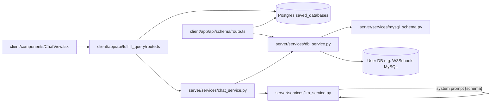

# Memplace (project memory)

Agents: read this file at the start of related tasks and update it when architecture or fixes change.

## File graph (navigation)

| Path | Role |
|------|------|
| `client/components/ChatView.tsx` | Generate → `/api/fullfill_query` |
| `client/app/api/fullfill_query/route.ts` | Load credentials from Postgres, call Flask |
| `client/app/api/schema/route.ts` | Verify connection, return schema text |
| `server/services/chat_service.py` | `fetch_schema` → LLM → `run_sql` |
| `server/services/db_service.py` | Schema introspection + SQL execution |
| `server/services/schema_reflect_ddl.py` | MetaData.reflect → CREATE TABLE DDL (same as course agent.py) |
| `server/services/llm_json_parse.py` | Parse `{sql, explanation}` from model |
| `server/services/w3schools_sql.py` | PascalCase W3Schools MySQL table names |
| `server/services/llm_service.py` | System prompt embeds full schema text |
| `server/core/config.py` | `server/.env`, OpenRouter key |
| `server/tests/test_w3schools_schema.py` | Country column + LLM prompt checks |
| `tests/test_cases.md` | Human-readable test case log |
| `server/data/sessions/<id>/*.log` | Per-session code change audit trail |

## Text-to-SQL flow
- **Next.js**: auth, saved DB credentials in Postgres, proxies to Flask.
- **Flask**: connects to user DB, **always** `fetch_schema()` before LLM, OpenRouter, read-only SQL.
- **Env**: `OPENROUTER_API_KEY` only in `server/.env` (`KEY=value`, no extra quotes).

## Reference implementation (works for user)
- Path: `Ai-course/3-text-to-sql/agent.py`
- MySQL `192.168.1.42:5246`, database **`w3schools`**, `mysql+pymysql`
- Schema: `MetaData().reflect()` → `CreateTable` DDL strings
- LLM: `ChatOpenAI.invoke`, JSON with `sql` + `explanation`, OpenRouter headers
- **App must use the same engine/DB** — PostgreSQL in Data Sources ≠ agent.py MySQL

## W3Schools / ClassicModels
- Sample DB has `customers.Country` (and `City`, `Address`, etc.).
- If the LLM asks “which table has country?”, schema text was empty — not an LLM-only bug.
- **PostgreSQL**: `db_name` = database; tables are in schema **`public`**. Fixed in `postgres_schema.py`.
- **MySQL**: `mysql_schema.py` + `information_schema`.

## Recent fixes
- Chat Generate uses header-selected DB id; Flask always refreshes schema.
- OpenRouter key: dotenv failed on `""key""`; load `server/.env` by absolute path.
- Postgres + MySQL schema introspection; country-question override when `Country` column exists.

## Operational notes
- Restart Flask after `.env` or server code changes.
- Flask logs: `postgres_schema`, `mysql_schema`, `fullfill_query` table counts.
